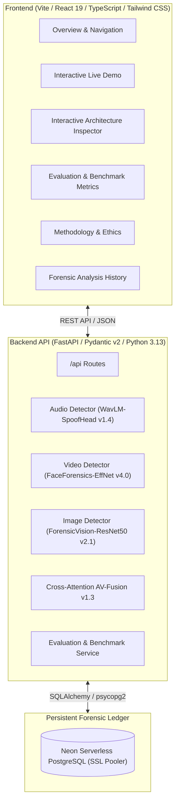

# DeepFakeShield — System Architecture

DeepFakeShield is a full-stack, multimodal deepfake detection and forensic analysis platform.

## High-Level Topology

## Modality Pipelines

### 1. Audio Stream
- **Input**: PCM Waveform (WAV, MP3, FLAC, OGG).
- **Preprocessing**: 16kHz resampling, zero-crossing rate (ZCR), spectral flatness, 12 frequency bands, 13 MFCC cepstral features.
- **Model**: WavLM representation encoder + trained spoof classification head.
- **Artifacts**: Phase vocoder inconsistencies, unnatural high-frequency roll-off, pitch jitter anomalies.

### 2. Visual Stream
- **Input**: Video frames (MP4, MOV, WEBM).
- **Preprocessing**: Keyframe extraction, face alignment, spatial normalization.
- **Model**: EfficientNet-B4 convolutional feature head.
- **Artifacts**: Poisson blending seams, corneal reflection asymmetry, temporal flickering.

### 3. Image Stream
- **Input**: Images (JPG, PNG, WEBP).
- **Preprocessing**: Channel variance analysis, high-frequency spatial edge filtering.
- **Model**: ForensicVision ResNet-50.
- **Artifacts**: Diffusion texture over-smoothing, chrominance imbalance, PRNU noise loss.

### 4. Cross-Attention Fusion
- Aligns phoneme timing with facial lip visemes.
- Discrepancy Gate: Flags modality-selective manipulation when |S_audio - S_video| > 0.45.
